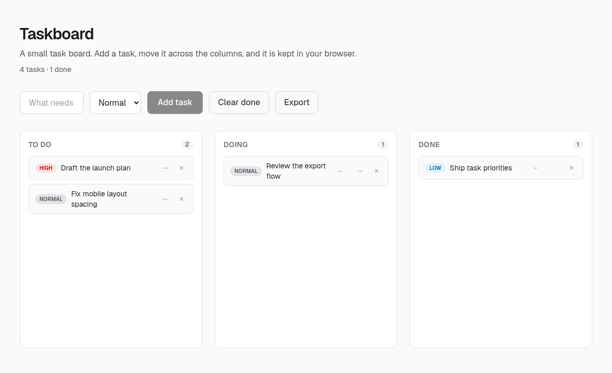

# Taskboard

A small task board: add tasks, move them across **To do → Doing → Done**, set
priorities, rename them inline, and export the board as JSON. Everything is
kept in the browser's localStorage, so there is no backend to run.

**[Open the live board →](https://gerrcass.github.io/taskboard/)**



This repository is the demo app for the
[software-factory](https://github.com/gerrcass/software-factory) pipeline:
issues labelled `ready` are implemented by AI agents in sandboxed workers, and
arrive back here as pull requests.

## Stack

- [Next.js](https://nextjs.org) 16 (App Router, TypeScript)
- [Tailwind CSS](https://tailwindcss.com) 4
- [Vitest](https://vitest.dev) for unit tests

## Getting started

```bash
npm ci
npm run dev
```

Open <http://localhost:3000>.

## Commands

| Command | What it does |
|---|---|
| `npm run dev` | Start the dev server |
| `npm run build` | Production build |
| `npm run lint` | ESLint |
| `npm run test` | Unit tests (Vitest) |

## Layout

- `src/lib/tasks.ts` — the domain logic: create, move, advance, retreat, delete
  and count tasks. Pure functions, no framework code.
- `src/lib/tasks.test.ts` — unit tests for the above.
- `src/app/page.tsx` — the board UI.
